# B2 · Comparação com o protótipo Rumo (DSG-06)

Cada imagem tem, **à esquerda, o protótipo** (`design/prototipos/rumo/`, paleta Eucalipto, aberto no Chromium em tela de 390 × 844 com `moldura=0&avaliador=0`) e, **à direita, o app** (galeria no emulador `campinguim-a`, 1080 × 2340, densidade 440). As duas na mesma altura.

O protótipo mostra telas com dados; a galeria mostra os componentes com dados de exemplo. A comparação é de forma, cor, letra, medida e estado, não de conteúdo.

## 1. Rota e cabeçalho da etapa (7.1, 7.2)

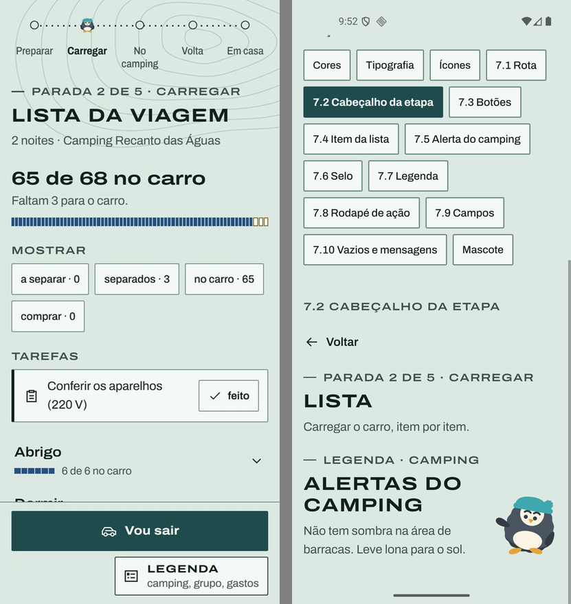

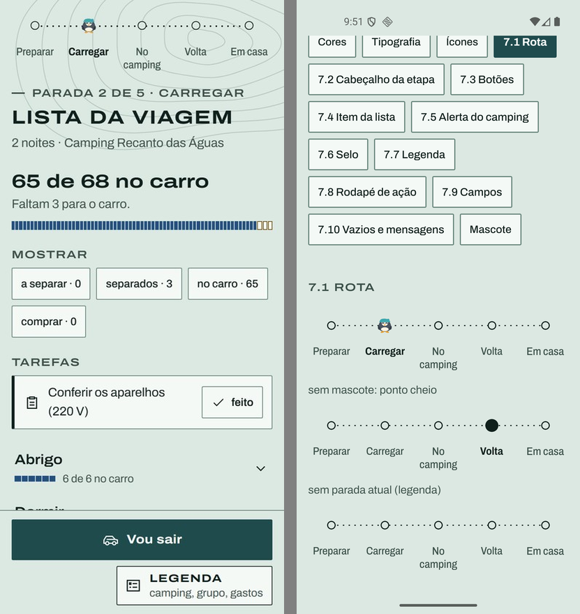

- Iguais: pontos de 12 com borda `texto`, tracejado 2/6, mascote `icone` de 24 na parada atual, nome em `texto-suave` (atual em `texto`, peso 700), largura 85; marca da etapa com o traço de 18; título em letreiro caixa alta 125; curvas de nível no topo.
- Divergência consciente: no app, a rolagem começa abaixo da barra de status do Android (o protótipo, no navegador, não tem barra de status).

## 2. Item da lista, categoria, régua e tarefa (7.4)

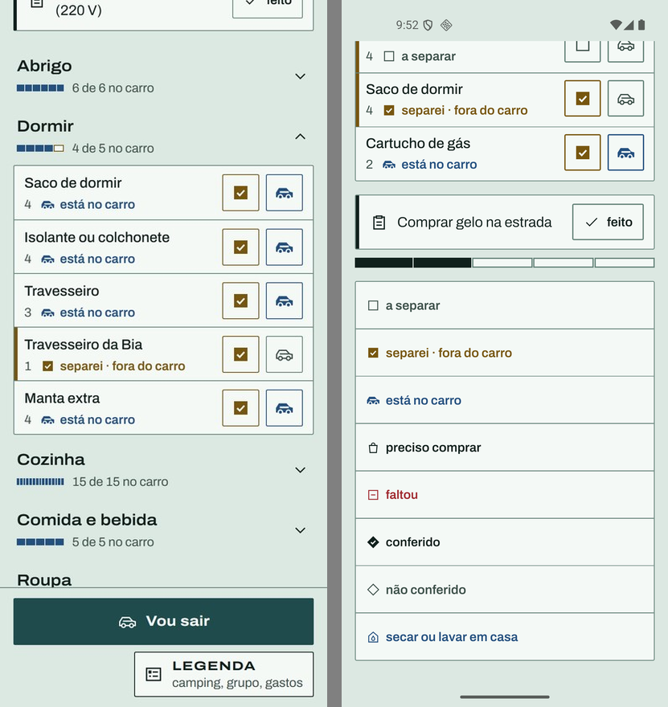

- Iguais: faixa de 4 `separei` nos itens fora do carro; estado com ícone e texto ("a separar", "separei · fora do carro", "está no carro"); as duas alternâncias de 44 com o ícone cheio quando ligadas e a borda na cor do estado; categoria com nome 19/24 largura 112,5, régua curta e "x de y no carro"; faixa de tarefa com borda de 4 `texto` e o botão "feito".
- Divergência consciente: nenhuma de forma. Os dados são de exemplo.

## 3. Alertas do camping (7.5)

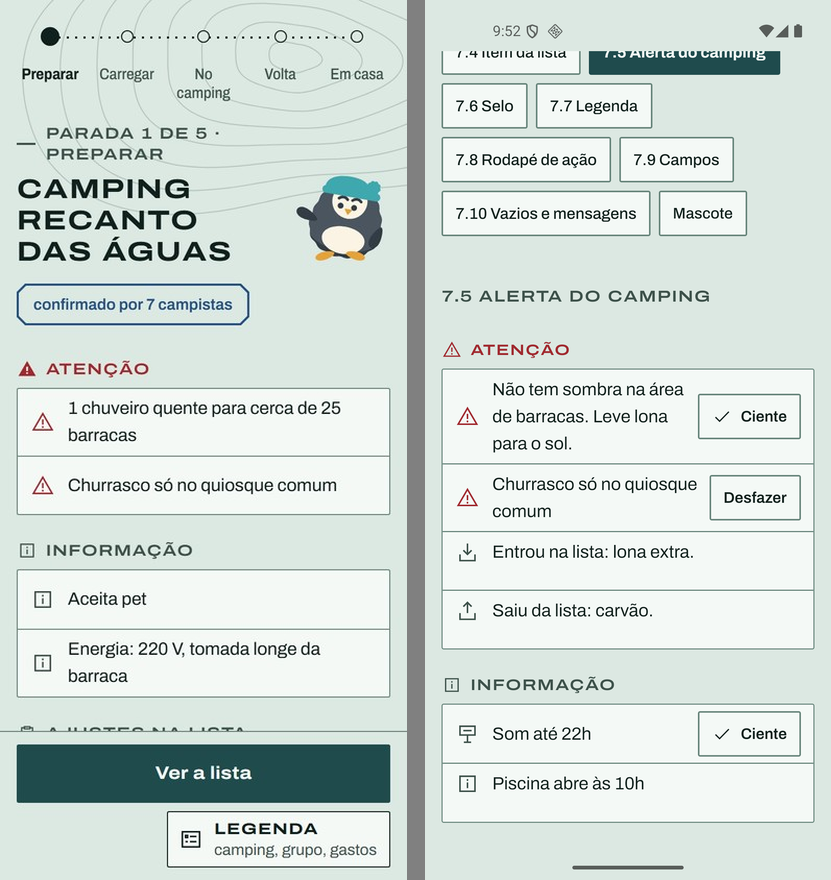

- Iguais: grupos por nível com título em rótulo de carta e ícone (Atenção em `atencao`, Informação em `texto-suave`); linha de folha com o ícone, o texto em `texto` e "Ciente" (que vira "Desfazer").
- O mascote `pose-alerta` de 96 aparece no cabeçalho da seção 7.2 da galeria (no máximo um mascote por tela).

## 4. Selo (7.6)

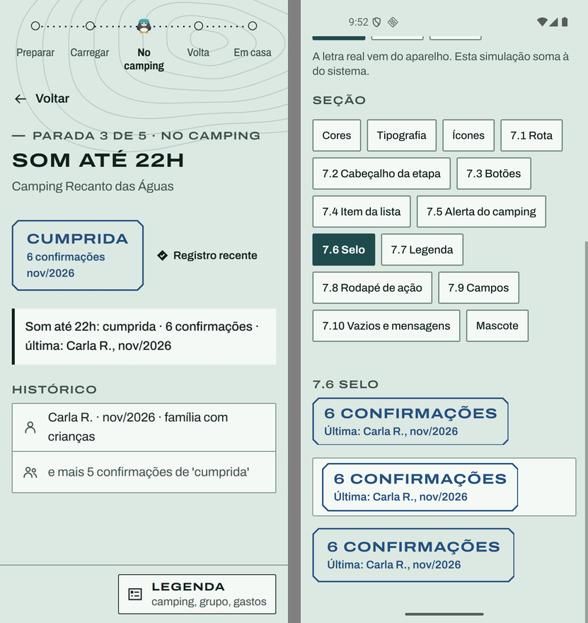

- Iguais: canto cortado de 8 (7 por dentro), traço de 2 `carro`, miolo `fundo` (ou `superficie` dentro de folha), texto grande em letreiro e linha de baixo em peso 600, tudo em `carro`. Nunca redondo.

## 5. Campos (7.9)

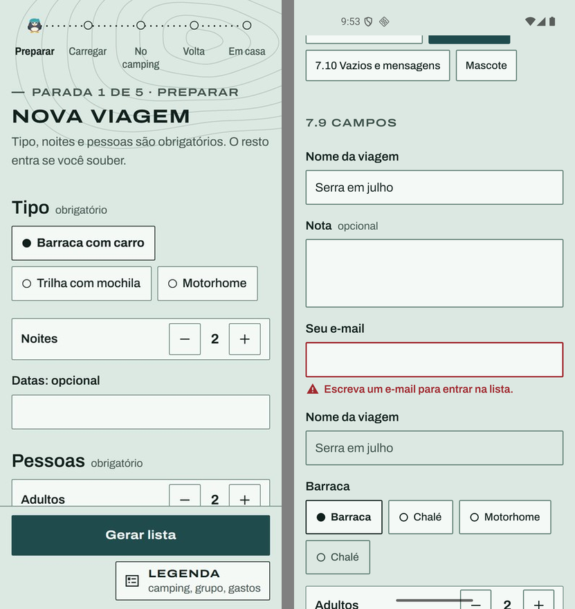

- Iguais: rótulo em peso 600 com "opcional" em `texto-suave`; campo de 48 com borda de 1,5 `linha` e fundo `superficie`; opção de 48 com a bolinha de 12; contador com passos de 44; resultado de busca com a faixa de 4 `texto` e "escolhido".
- Divergência consciente (D-5, decisão desta feature): o **erro do campo** tem borda `atencao` e, embaixo, o ícone de atenção e a frase em `atencao`. O protótipo não tem forma de erro.

## 6. Legenda aberta (7.7)

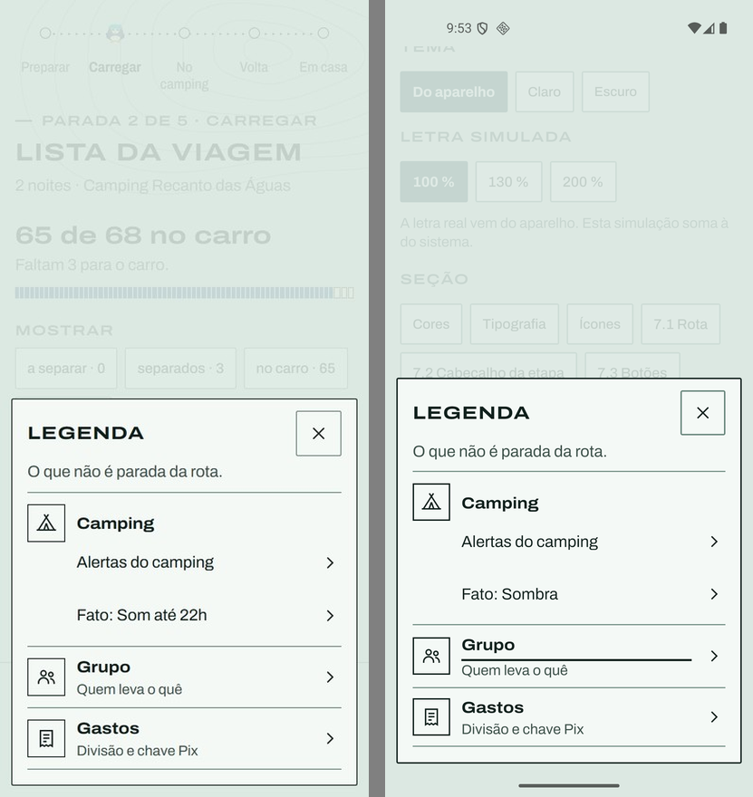

- Iguais: painel que abre de baixo sobre o `fundo` a 88 %, borda de 1,5 `texto`, título em letreiro, "Fechar" de 48, entradas com símbolo em caixa de 40 e ligações de 48, a entrada atual sublinhada com 2.
- Divergência consciente: o painel aparece sem animação (movimento até 200 ms; DESIGN.md 5).

## 7. Rodapé de ação e botões (7.3, 7.8)

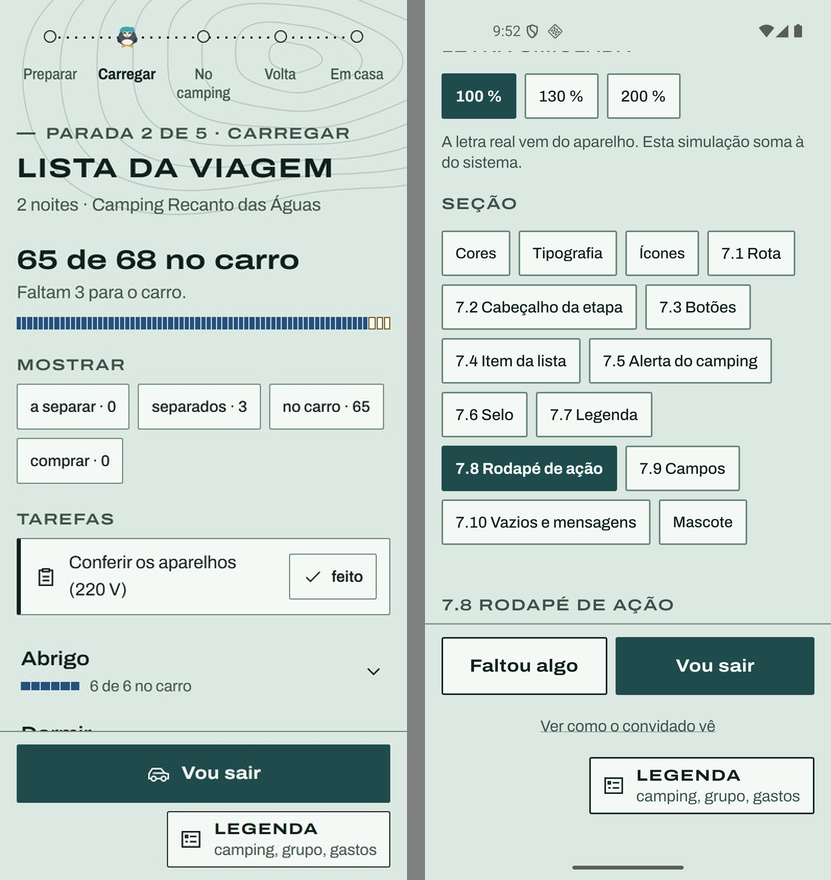

- Iguais: faixa em `fundo` com linha de 1 `linha` em cima; principal em `acento` com letra `sobre-acento` 17/22 largura 112,5 peso 700 e o dobro do espaço do secundário; secundário com borda de 1,5 `texto`; botão da legenda à direita, com "LEGENDA" e "camping, grupo, gastos".
- Divergência consciente: estados de **pressão** e **desativado** (o protótipo não desenha; `docs/componentes.md`, seção 7.2).

## 8. Vazio e mensagens (7.10)

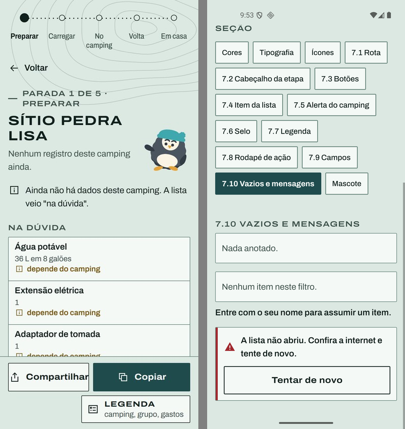

- Iguais: vazio em `texto-suave` com respiro de 16/12; mensagem em peso 600, anunciada.
- Divergência consciente (D-5): a **mensagem de erro** com faixa de 4 `atencao`, ícone de atenção cheio, frase em `texto` e a ação ("Tentar de novo").

## 9. Tema escuro

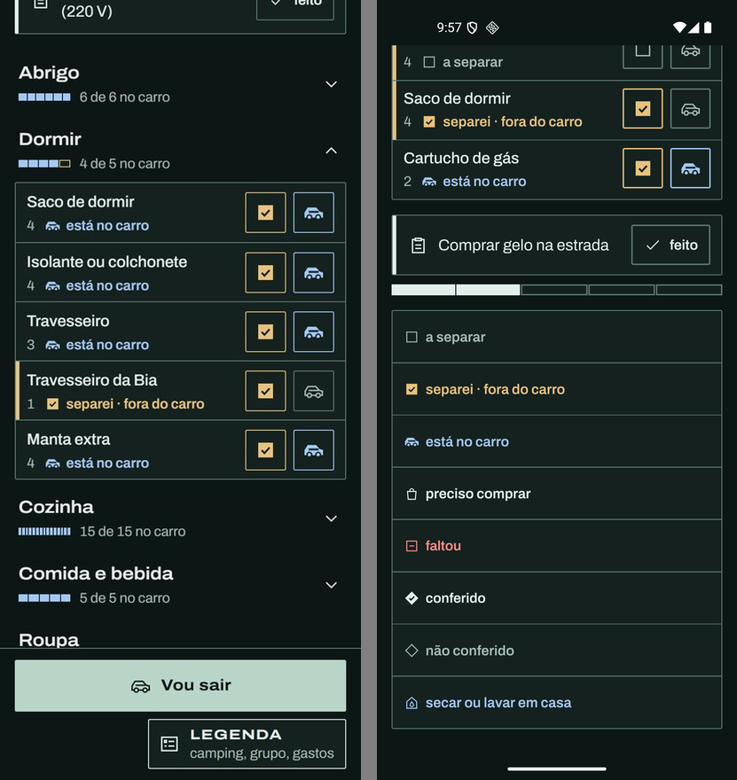

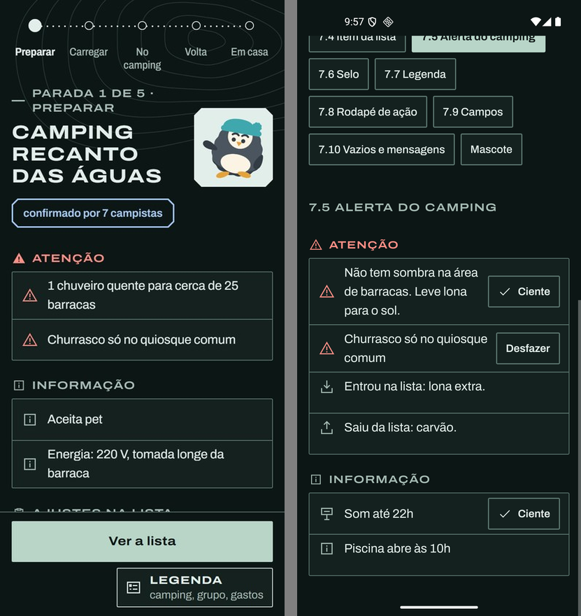

- Iguais: os 10 papéis do escuro da Eucalipto; o mascote colorido sobre o papel `texto` de canto cortado.

## Divergências conscientes, resumo

| # | O quê | Por quê |
| --- | --- | --- |
| 1 | Rolagem abaixo da barra de status | Barra do Android; o protótipo roda no navegador |
| 2 | Forma do erro (campo e mensagem) | Decisão D-5: ícone + texto + ação, nunca só cor |
| 3 | Pressão e desativado | O protótipo não desenha; sempre nos 10 papéis, sem opacidade, contraste ≥ 4,5 |
| 4 | Legenda sem animação | Movimento até 200 ms |
| 5 | Sem contorno de foco próprio | No celular, o foco é o do TalkBack |
| 6 | Fonte em 12 arquivos fixos | O Android não aplica os eixos da fonte variável; mesmas larguras e pesos |
